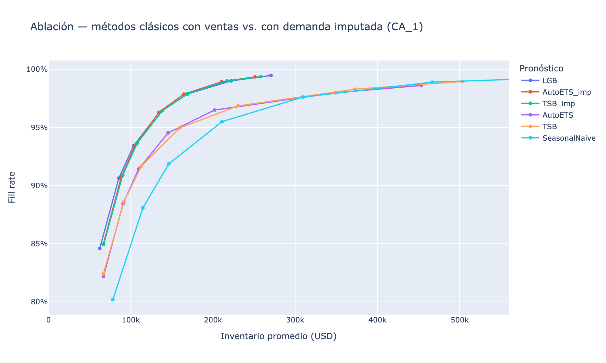

# Del pronóstico a la decisión de inventario — Walmart M5 (tienda CA_1)

Pronóstico de demanda para los productos de una tienda Walmart, convertido en decisiones de reabasto: una simulación de política (R, S) mide cuánto inventario ahorra un mejor pronóstico, y una ablación separa cuánto viene del modelo y cuánto de corregir la demanda censurada por agotados.

## Resultados

**El hallazgo principal es de datos, no de modelo.** M5 registra ventas, no demanda: cuando un producto se agota, la venta es cero aunque haya clientes. Corregir esos días reduce el inventario necesario en una cuarta parte con cualquier modelo.

| Comparación (costo en el nivel de servicio óptimo; IC 95% por bootstrap de productos) | Costo total | Inventario a fill rate 95% |
|---|---|---|
| **Corregir la censura** · TSB con demanda corregida vs. con ventas | **−27.6%** (−31.8 a −23.5) | **−23.8%** (−34.5 a −18.8) |
| **Corregir la censura** · AutoETS con demanda corregida vs. con ventas | **−24.7%** (−29.7 a −19.7) | **−23.8%** (−33.4 a −15.5) |
| **Modelo** · LightGBM vs. AutoETS con demanda corregida | +2.6% (−1.4 a +6.0) | −0.3% (−4.9 a +3.9) |
| **Modelo** · LightGBM vs. TSB con demanda corregida | +2.1% (−1.0 a +5.3) | −1.8% (−5.8 a +2.0) |

- LightGBM (entrenado sin días censurados) tiene la mejor precisión en la prueba final (RMSSE 0.755 vs. 0.763 de AutoETS) y el menor sesgo (−1.0% vs. −7.6%). Pero con la demanda corregida, TSB y AutoETS lo igualan en inventario y costo: la diferencia no es significativa.
- El efecto de la censura se mantiene en los 9 escenarios de costo de mantener (15–35% anual) × margen perdido (20–50%): entre 17% y 41% de ahorro.
- El detector de agotados encuentra casi cualquier agotado de 7 días o más en productos que venden con regularidad, y en series sintéticas sin agotados marca solo 0.36% de los días (vs. 2.69% en los datos reales): ~86% de las detecciones serían reales. En productos que venden menos de la mitad de los días es ciego por diseño, así que el efecto medido es una cota inferior.



## Metodología

| Notebook | Contenido |
|---|---|
| `01_eda` | Clasificación Syntetos-Boylan (ADI/CV²), matriz ABC-XYZ, estacionalidad y SNAP. |
| `02_baselines` | Detección de demanda censurada y 6 métodos clásicos (statsforecast) en backtest de 3 ventanas de 28 días. |
| `03_lightgbm` | LightGBM global (Tweedie) con rezagos ≥ 28 días, entrenado sin días censurados. |
| `04_inventario` | Simulación (R, S) de 2,467 productos y exportación de datos para la página del portafolio. |
| `05_validacion_final` | Prueba reservada de 28 días (evaluada una sola vez) y sensibilidad a los supuestos de costo. |
| `06_ablacion_censura` | TSB y AutoETS entrenados con ventas y con demanda corregida, en la misma simulación: separa el efecto del modelo del de los datos. |
| `07_validacion_detector` | Agotados artificiales insertados en series reales (sensibilidad) y series sintéticas sin agotados (falsas alarmas). |
| `08_incertidumbre` | Intervalos de confianza por bootstrap de productos (2,000 réplicas). |

**Demanda censurada** (`src/censura.py`). Sin datos de inventario, una racha de ceros se marca como *agotado* si es improbable dado el ritmo de venta de los 56 días previos, e *inactivo* si dura 90 días o más. Resultado: 9.9% de días-producto inactivos y 2.7% agotados (rango de sensibilidad: 0.9–7.2%).

**Inventario** (`src/simulate.py`). Revisión semanal, lead time de 7 días, ventas perdidas, 26 pedidos semanales entre oct 2015 y abr 2016 (las 2 primeras semanas no se miden). El nivel objetivo es `S = F + z·√(F+1)`, donde F es el pronóstico acumulado de 13 días y z es un cuantil empírico del error fuera de muestra en las 13 semanas previas a la simulación, por **clase de demanda × quintil de volumen pronosticado**. `04_inventario` también reporta la calibración solo por clase como comparación (`simulacion_inventario_CA_1.csv`).

## Reproducir

```bash
uv sync
# Coloca los archivos de la competencia M5 (Kaggle) en data/raw/
uv run python src/prepare_data.py # filtra la tienda CA_1 → data/processed/
# Ejecuta los notebooks en orden: 01 → 08 (06 tarda ~25 min por AutoETS)
uv run python src/export_web.py   # resumen.json para la página del portafolio
```

## Limitaciones

- Costos, lead time y periodo de revisión son supuestos: M5 no incluye inventario ni costos reales.
- Los agotados se infieren de las ventas; sin registros de inventario no pueden confirmarse.
- La demanda corregida se usa para entrenar y también como demanda real en la simulación (2.6% de los días), lo que puede favorecer ligeramente a los modelos corregidos.
- Una sola tienda (CA_1); el pipeline escala a las 10 tiendas, pero no se evaluó ahí.
- El LightGBM de la simulación se entrenó una sola vez; reentrenarlo periódicamente probablemente mejoraría el resultado.

## Stack

Python · Polars · pandas · LightGBM · statsforecast · NumPy · Plotly
