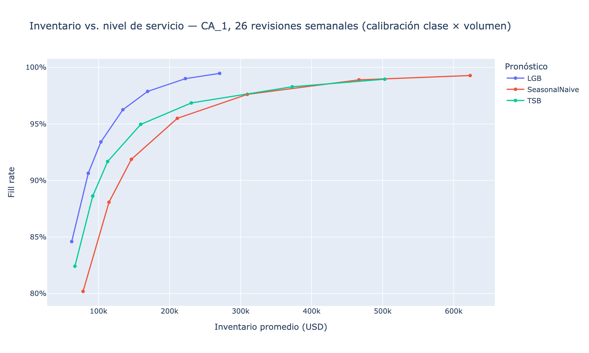

# Del pronóstico a la decisión de inventario — Walmart M5 (tienda CA_1)

Pronóstico de demanda con LightGBM para los productos de una tienda Walmart, convertido en decisiones de reabasto: una simulación de política (R, S) mide cuánto inventario y cuántos faltantes ahorra un mejor pronóstico.

## Resultados

| | LightGBM | Referencia |
|---|---|---|
| RMSSE prueba final (28 días reservados, sin días censurados) | **0.755** | 0.763 (AutoETS, mejor clásico) |
| Sesgo en la prueba final | **−1.0%** | −7.6% (AutoETS), −4.2% (TSB) |
| Inventario para un fill rate de 95% | **−25%** vs. TSB | |
| Costo total en el nivel de servicio óptimo de cada modelo | **−26%** vs. TSB, **−36%** vs. seasonal naive | |

- La mejora en precisión es modesta (1–3%); el aporte principal es eliminar el sesgo. Los métodos clásicos aprenden de ventas censuradas por agotados y subestiman la demanda.
- Si se evalúan también los días de agotado (venta 0 con demanda), AutoETS supera a LightGBM, justamente porque pronostica esos ceros.
- El ahorro de costo frente a TSB se mantiene en los 9 escenarios de costo de mantener (15–35% anual) × margen perdido (20–50%): entre 18% y 40%.



## Metodología

| Notebook | Contenido |
|---|---|
| `01_eda` | Clasificación Syntetos-Boylan (ADI/CV²), matriz ABC-XYZ, estacionalidad y SNAP. |
| `02_baselines` | Detección de demanda censurada y 6 métodos clásicos (statsforecast) en backtest de 3 ventanas de 28 días. |
| `03_lightgbm` | LightGBM global (Tweedie) con rezagos ≥ 28 días, entrenado sin días censurados. |
| `04_inventario` | Simulación (R, S) de 2,467 productos y exportación de datos para la página del portafolio. |
| `05_validacion_final` | Prueba reservada de 28 días (evaluada una sola vez) y sensibilidad a los supuestos de costo. |

**Demanda censurada** (`src/censura.py`). Sin datos de inventario, una racha de ceros se marca como *agotado* si es improbable dado el ritmo de venta de los 56 días previos, e *inactivo* si dura 90 días o más. Resultado: 9.9% de días-producto inactivos y 2.7% agotados (rango de sensibilidad: 0.9–7.2%).

**Inventario** (`src/simulate.py`). Revisión semanal, lead time de 7 días, ventas perdidas, 26 pedidos semanales entre oct 2015 y abr 2016 (las 2 primeras semanas no se miden). El nivel objetivo es `S = F + z·√(F+1)`, donde F es el pronóstico acumulado de 13 días y z es un cuantil empírico del error fuera de muestra en las 13 semanas previas a la simulación, por **clase de demanda × quintil de volumen pronosticado**. `04_inventario` también reporta la calibración solo por clase como comparación (`simulacion_inventario_CA_1.csv`).

## Reproducir

```bash
uv sync
# Coloca los archivos de la competencia M5 (Kaggle) en data/raw/
uv run python src/prepare_data.py # filtra la tienda CA_1 → data/processed/
# Ejecuta los notebooks en orden: 01 → 05
uv run python src/export_web.py   # resumen.json para la página del portafolio
```

## Limitaciones

- Costos, lead time y periodo de revisión son supuestos: M5 no incluye inventario ni costos reales.
- Los agotados se infieren de las ventas; sin registros de inventario no pueden confirmarse.
- Una sola tienda (CA_1); el pipeline escala a las 10 tiendas, pero no se evaluó ahí.
- El LightGBM de la simulación se entrenó una sola vez; reentrenarlo periódicamente probablemente mejoraría el resultado.

## Stack

Python · Polars · pandas · LightGBM · statsforecast · NumPy · Plotly
